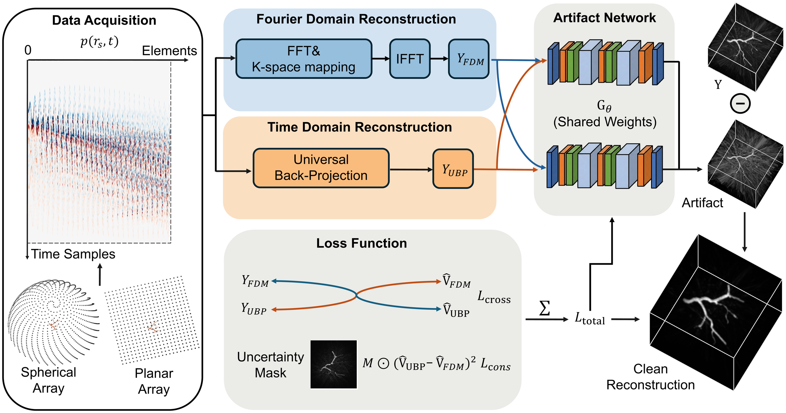
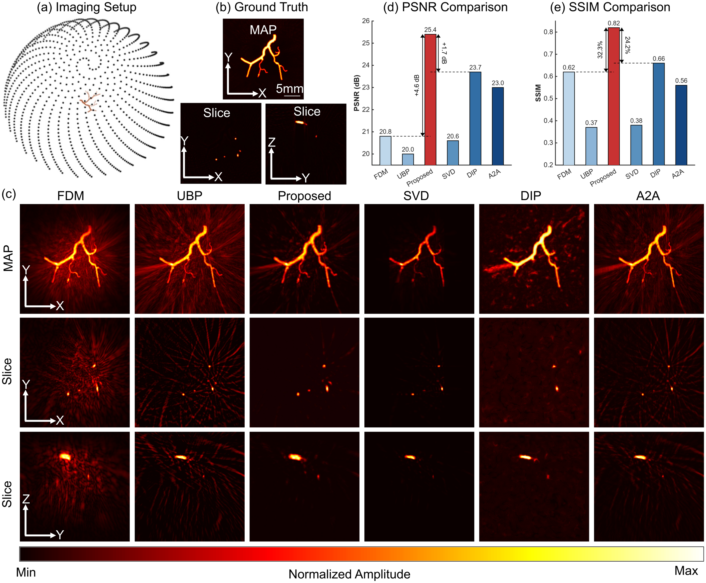

# Dual-Domain Self-Supervised Artifact Removal Framework for Photoacoustic Computed Tomography

Photoacoustic Computed Tomography (PACT) often faces severe challenges from reconstruction artifacts due to sparse detection conditions. In this work, based on the distinct differences in artifact patterns between back-projection-based and Fourier-based reconstruction algorithms, we propose a self-supervised artifact removal framework that employs a lightweight Siamese Neural Network and a composite loss function integrating cross-domain fidelity and uncertainty-weighted consistency, effectively decoupling dual-domain features and filtering artifacts. Comprehensive validations using simulations, phantoms, in vivo rat and human experimental data demonstrate that the proposed method can significantly suppress image artifacts. Furthermore, enabled by the acceleration of the spatial-domain and frequency-domain inverse operator, this end-to-end approach also achieves exceptional computational efficiency.

The paper is available on arXiv: [arXiv:2607.16304](https://arxiv.org/abs/2607.16304).

## Method

The framework reconstructs the same sparse PACT measurements using Fourier-domain reconstruction (FDM) and universal back-projection (UBP). A shared-weight artifact network then learns from their complementary artifact patterns using cross-domain fidelity and uncertainty-weighted consistency losses.



*Overview of the dual-domain self-supervised artifact removal framework.*

## Numerical Phantom Data

The data provided in `data/` are the **Numerical Phantom** data used for the simulation experiment. 



*Numerical Phantom setup and comparison of FDM, UBP, the proposed method, SVD, DIP, and A2A.*

## Repository Structure

```text
.
|-- main.py 
|-- reconstruction.py
|-- artifact_removal.py
|-- visualization.py
|-- data/
|   |-- sensor_signal.npz
|   `-- sensor_location.txt
|-- figure/
|   |-- Numerical_Phantom.pdf
|   `-- Numerical_Phantom.png
`-- requirements.txt
```

## Installation

```bash
git clone https://github.com/Zcdll/D2S-PACT.git
cd D2S-PACT
```
```
conda create -n D2S_PACT python=3.9 -y
conda activate D2S_PACT
conda install pytorch torchvision torchaudio pytorch-cuda=11.8 -c pytorch -c nvidia
```
```
pip install -r requirements.txt
```

## Usage

Run the complete reconstruction, artifact-removal, and visualization pipeline through `main.py`. Select one method per run with `--method`.

```bash
python main.py --method proposed
python main.py --method a2a
python main.py --method dip
python main.py --method svd
```

Custom input paths can be supplied without changing the experiment parameters:

```bash
python main.py --method proposed \
  --signals data/sensor_signal.npz \
  --locations data/sensor_location.txt \
  --output output/custom_result.npy
```

The signal loader reads the `signals` array from `.npz` archives. Whitespace-delimited `.txt` signal matrices remain supported for custom datasets.
If you have any questions, please be free to contact us. (email address: yuchengzhou25@stu.pku.edu.cn)
## Methods

| `--method` | Description |
| --- | --- |
| `proposed` | Dual-domain shared residual network with cross-domain and uncertainty-weighted losses |
| `a2a` |Zero-shot Artifact2Artifact|
| `dip` |3D Deep Image Prior|
| `svd` |SVD of the shared FDM and UBP volume component|

## Reproduction Parameters

| Stage | Parameter | Value |
| --- | --- | ---: |
| Sampling | Detector stride | 8 |
| Acquisition | Sampling rate | 40 MHz |
| Acquisition | Sound speed | 1500 m/s |
| Reconstruction | Voxel size | 0.1 mm |
| Reconstruction | Field of view | 25.6 x 25.6 x 25.6 mm^3 |
| Reconstruction | Grid size | 256 x 256 x 256 |

## Citation

```bibtex
@article{zhou2026dual,
  title   = {Dual-Domain Self-Supervised Artifact Removal Framework for Photoacoustic Computed Tomography},
  author  = {Zhou, Yucheng and Li, Shuang and Zhang, Yu and Wang, Yibing and Kim, Chulhong and Choi, Seongwook and Li, Changhui},
  journal = {arXiv preprint arXiv:2607.16304},
  year    = {2026},
  url     = {https://arxiv.org/abs/2607.16304}
}
```

## Acknowledgments

This work was supported by:

- National High-Level Hospital Clinical Research Funding (No.2025-PUMCH-C-052)
- Beijing Natural Science Foundation (No.7232177)
- National Key R&D Program of China (No.2023YFC2411700)
- Basic Science Research Program through the National Research Foundation of Korea (NRF), funded by the Ministry of Education (No.2020R1A6A1A03047902)

This work was also supported by the Biomedical Computing Platform of the National Biomedical Imaging Center at Peking University.
